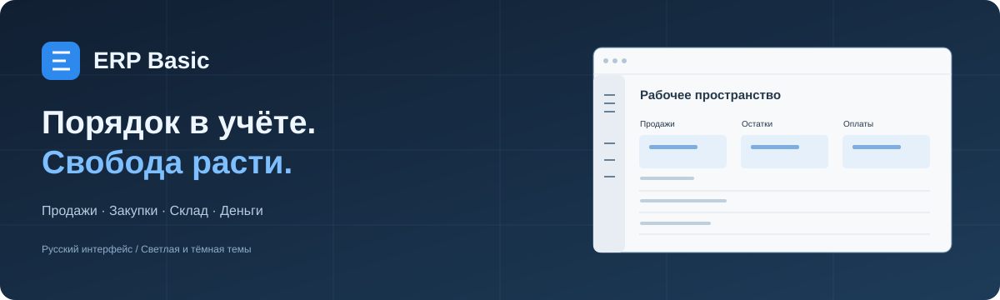
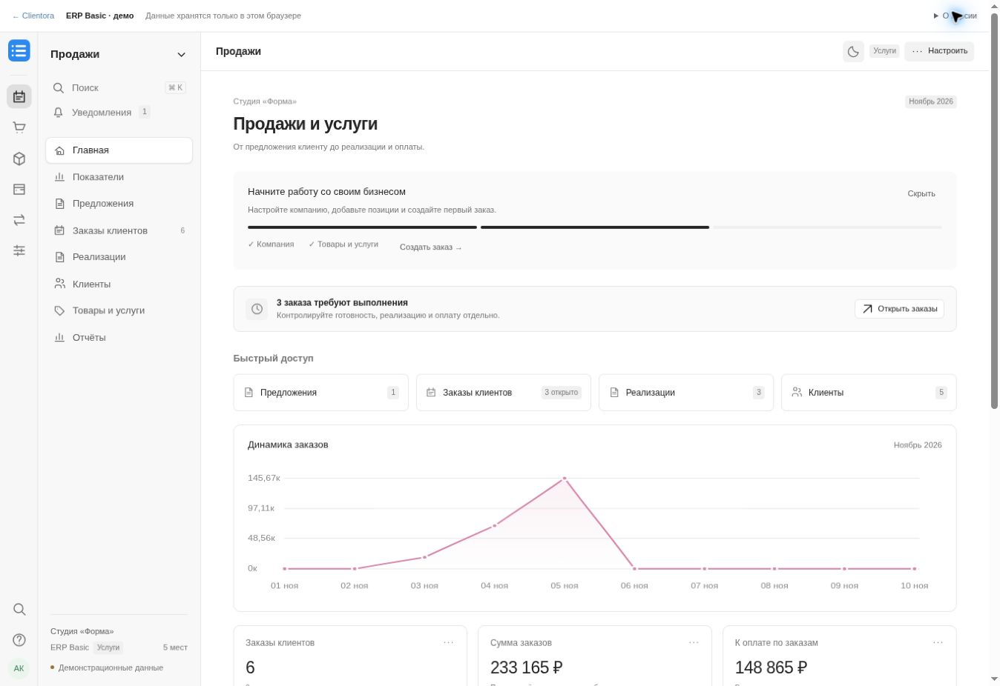
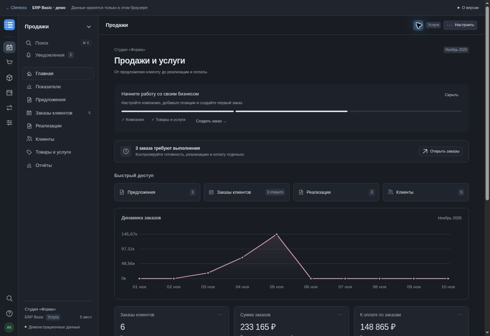

<p align="center"></p>

# ERP Basic — базовая ERP для малого бизнеса

**Продажи, закупки, склад и деньги — в одном рабочем пространстве.**

Русский интерфейс · светлая и тёмная темы · отдельная браузерная демонстрация и серверное приложение на ERPNext.

**[Открыть демонстрацию ERP Basic](https://deatin.github.io/ERPBasic/)** — работает в браузере, без установки.

[Обсуждения и помощь](https://github.com/DEATIN/ERPBasic/discussions) · [Публичная доска](https://github.com/users/DEATIN/projects/2) · [Выпуски](https://github.com/DEATIN/ERPBasic/releases) · [Справка](https://github.com/DEATIN/ERPBasic/wiki)

[Демонстрация](#быстрый-запуск-демонстрации) · [Сервер](#запуск-сервера) · [Руководство](документация/Руководство.md) · [Архитектура](docs/adr/0001-server-foundation.md) · [План развития](документация/План-развития.md)

## Два режима

**Серверный ERP Basic — отдельное Frappe-приложение над штатным ERPNext.** Документы,
проведение, складская стоимость и взаиморасчёты используют стандартные контроллеры и
регистры ядра. Несколько сотрудников работают с одной серверной базой своего клиента.
Упрощённый интерфейс открывается по `/erp` установленного Site.

**Публичная GitHub Pages остаётся локальной демонстрацией.** Она помогает познакомиться
с компоновкой и сценариями без установки сервера. Её JSON и расчёты в браузере не являются
серверной бухгалтерской базой. При недоступности сервера `/erp` показывает ошибку и не
переключается на демо.

| Область | Серверный режим | Публичная демонстрация |
|---|---|---|
| Хранение | MariaDB отдельного Frappe Site | `localStorage` текущего браузера |
| Пользователи | Frappe login, сессии, роли и Company User Permission | Локальный профиль |
| Документы и движения | Native ERPNext, транзакции и устойчивые ключи команд | Демонстрационная модель JavaScript |
| Склад | Moving Average, запрет отрицательного остатка, возвраты, отмена | Упрощённые локальные расчёты |
| Обмен Clientora | Реальные HTTP, outbox/inbox, версии, журнал и разбор конфликтов | Экраны демонстрации |
| Резервная копия | База, файлы, версия кода и отдельно защищённые ключи | JSON браузера |

Профиль установки и испытаний готов для самостоятельного размещения на Linux. Рабочие
TLS, мониторинг, расписание и удалённое хранение копий настраиваются для конкретного
сервера. Это ещё не развёрнутый производственный сервис. Проверенные сценарии и границы
результата перечислены в [отчёте о проверках](docs/verification.md).

## Запуск сервера

Следуйте [инструкции окружения](infra/README.md): она фиксирует версии, checksum,
создание Site, сборку assets, HTTP, worker, scheduler, диагностику и восстановление.
Испытанная связка: **Frappe 15.126.0, ERPNext 15.124.5, MariaDB 10.11.19
с READ-COMMITTED и Redis 7.2.17**. Python 3.12.14 и Node 24.22.1 закреплены для CI.

После `new-site` создайте первую Company через `erp_basic.setup.create_company` либо
штатную настройку ERPNext. Администратор получает случайный индивидуальный пароль в
защищённом файле окружения. Сотрудников приглашает администратор; отдельному пользователю
нужны разрешённые Company и соответствующая роль. Без Company доступ закрыт.

```bash
bench --site erp-basic.localhost execute erp_basic.setup.create_company \
  --kwargs '{"name":"Моя компания","abbreviation":"MC","currency":"RUB","country":"Russian Federation"}'
```

Вход: `http://erp-basic.localhost:18000/erp`. Встроенный профиль слушает loopback;
для удалённого доступа требуется собственный HTTPS reverse proxy. Демо-данные не
загружаются в рабочий Site автоматически.

| Документация | Содержание |
|---|---|
| [Архитектурное решение](docs/adr/0001-server-foundation.md) | Почему Frappe-приложение, версии, Site/Company, учётная политика |
| [Документы и права](docs/documents-and-access.md) | Native DocTypes, роли, доступ к API, отчётам и вложениям |
| [Серверный интерфейс](docs/server-interface.md) | Формы, пагинация, конфликты и повтор потерянного запроса |
| [Обмен с Clientora](docs/clientora-integration.md) | Матрица владельцев, контракт, подключение и журнал |
| [Контрольная миграция](docs/migration.md) | Dry run, начальные остатки, архив истории и сверка |
| [Окружение и восстановление](infra/README.md) | Установка, CI, backup/restore, закрытый контур и RPO/RTO |
| [Проверки](docs/verification.md) | Фактические результаты и ещё не проверенные области |
| [Уведомления о компонентах](THIRD_PARTY.md) | Лицензии и авторство без изменения лицензии ERPBasic |

## Что можно попробовать в демонстрации

| Задача | Что можно попробовать |
|---|---|
| Продать товар или услугу | Предложение → заказ клиента → реализация → оплата |
| Закупить материалы | Заказ поставщику → поступление → изменение остатка |
| Проверить склад | Остатки, резервы, минимальный запас, списание и инвентаризация |
| Разобраться с деньгами | Оплаты, авансы, возвраты, расходы и задолженность |
| Посмотреть результат | Продажи, валовая прибыль и управленческие показатели |
| Подготовить перенос данных | Выгрузки CSV и резервная копия JSON |

## Быстрый запуск демонстрации

Скачайте репозиторий или клонируйте его. Для просмотра достаточно Python 3:

```bash
python3 инструменты/запуск.py
```

В Windows:

```powershell
py инструменты/запуск.py
```

Откройте **http://127.0.0.1:8000/**. Установка пакетов и база данных для этой версии не нужны. Для остановки нажмите `Ctrl+C`.

Для проверки кода нужен Node.js 22:

```bash
npm run проверка
npm run тесты
```

## Попробуйте за пять минут

1. Откройте **Продажи → Заказы клиентов** и создайте заказ с несколькими строками.
2. Сохраните и подтвердите документ. Создайте связанную реализацию.
3. Зарегистрируйте частичную оплату и проверьте остаток задолженности.
4. Откройте **Закупки**, создайте заказ поставщику и поступление.
5. Проверьте изменение остатков в разделе **Склад**.
6. Переключите тему и сохраните резервную копию в настройках.

## Как выглядит интерфейс



<details><summary>Посмотреть тёмную тему</summary>



</details>

## Где хранятся данные демонстрации

В локальном хранилище текущего браузера. Другой браузер, устройство или адрес сайта получает отдельный набор данных. Очистка хранилища удалит изменения. Перед очисткой сохраните резервную копию JSON в настройках.

Демонстрационные операции не списывают деньги и не создают банковских документов. Показатели показывают поведение локальной модели. Регламентированный и налоговый учёт в этой версии не реализован.

## Как соотносятся решения

| Решение | Назначение |
|---|---|
| **Clientora CRM** | Работа с клиентами, запись, загрузка ресурсов и выполнение услуг |
| **ERP Basic** | Базовый управленческий учёт небольшой компании |
| **ERP Business на базе ERPNext** | Целевой расширенный контур: производство, проекты и несколько компаний |

В серверном режиме Basic уже использует документы и регистры ERPNext. Включение полного
Desk и дополнительных модулей расширяет тот же Site; документы не пересоздаются. Проверена
сохранность native ID и записей регистра при открытии полного режима. Производство, проекты,
локализация регламентированного учёта и новые правила доступа требуют отдельного внедрения.
Для старой браузерной демонстрации подготовлен контролируемый импорт JSON v2; исторические
движения, которых в исходнике нет, не придумываются.

## Участие и общение

Описывайте ошибки, предложения, обсуждения и изменения **на русском языке**. Используйте готовые формы задач. Для ошибки приложите шаги, ожидаемый результат и снимок экрана с демонстрационными данными.

- [Как внести вклад](CONTRIBUTING.md)
- [Правила общения](CODE_OF_CONDUCT.md)
- [Как сообщить об уязвимости](SECURITY.md)
- [Как устроена совместная работа](документация/Совместная-работа.md)

## Возможности публичного проекта

| Инструмент | Как используется |
|---|---|
| Обсуждения | Помощь с отметкой полезного ответа, идеи, опросы и примеры использования |
| Задачи | Русские формы ошибок, предложений и вопросов; метки для поиска |
| План развития | Публичная доска «Запланировано → В работе → Готово» и этапы 0.4.0 / 1.0.0 |
| Безопасность | CodeQL, Dependabot, защита от публикации секретов и приватные сообщения об уязвимостях |
| Изменения | CODEOWNERS, обязательные проверки основной ветки и автоматическое удаление слитых веток |
| Выпуски | Проверяемый архив, SHA-256 и подтверждение происхождения сборки; опубликованные выпуски неизменяемы |
| Разработка | Готовая конфигурация Dev Containers / Codespaces с Node.js 22 и Python 3.12 |

Свободная лицензия пока не выбрана. Публичный доступ к репозиторию сам по себе не заменяет лицензию на использование и распространение кода.

## Проверки и публикация

Существующие проверки демонстрации сохранены. Node также проверяет серверный транспорт,
сессии и восстановление запросов. Отдельный CI устанавливает настоящие MariaDB/Redis и
ERPNext, проводит документы, запускает гонки нескольких процессов, HTTP-проверки,
миграцию и восстановление. Chromium проверяет интерфейс на явно обозначенных
контрактных HTTP-фикстурах; это дополнительная проверка UI, не замена реальному серверу.
Команды и фактические результаты приведены в [отчёте](docs/verification.md).

Демонстрация публикуется через **GitHub Pages → GitHub Actions**. Процесс публикует только содержимое `dist/`. Интерфейс работает и на странице проекта с вложенным адресом. Выпуски готовятся отдельным ручным процессом после проверок; порядок описан в [руководстве по совместной работе](документация/Совместная-работа.md).

## Устройство проекта

| Каталог | Содержимое |
|---|---|
| `dist/` | Готовый интерфейс и стили |
| `tests/` | Проверки демо, серверного транспорта и интерфейса |
| `erp_basic/` | Frappe-приложение, HTTP API, `/erp`, DocTypes и серверные тесты |
| `infra/` | Версии, lock-файлы, окружение и правила резервного копирования |
| `инструменты/` | Локальный запуск, сборка выпуска и серверные сценарии |
| `docs/` | Серверная архитектура, права, интеграция, миграция и проверки |
| `документация/` | Руководство демонстрации и общий план развития |
| `материалы/` | Обложка и изображения интерфейса |
| `.github/` | Формы задач, шаблон изменений и автоматические проверки |
| `.devcontainer/` | Подготовленная среда разработки |

Сервер использует [ERPNext](https://github.com/frappe/erpnext) без собственного форка.
Браузерная демонстрация остаётся самостоятельным HTML/CSS/JavaScript-приложением;
установка Frappe для неё не требуется.
